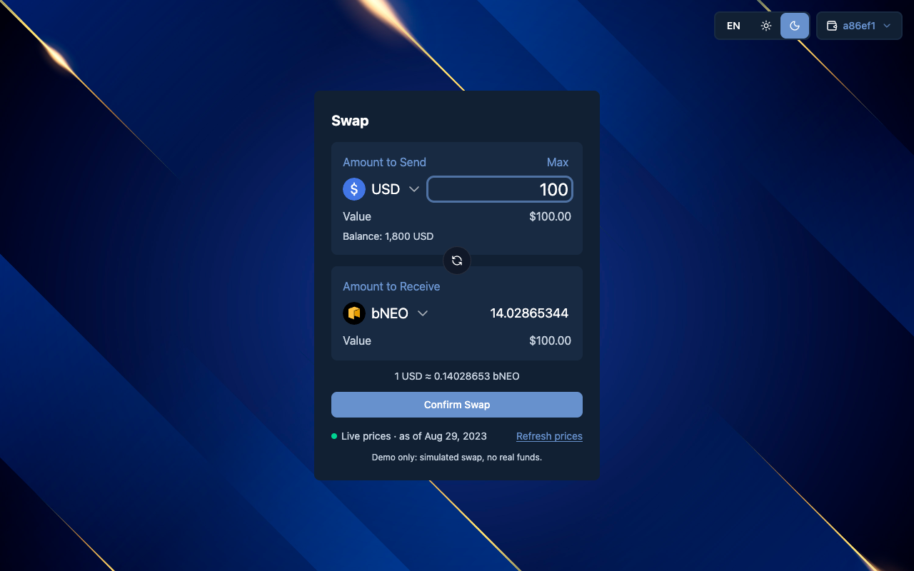
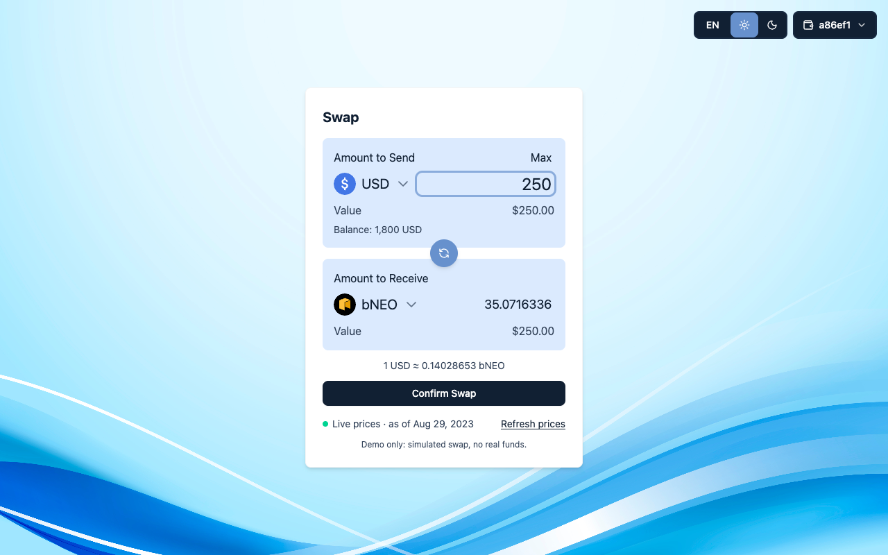
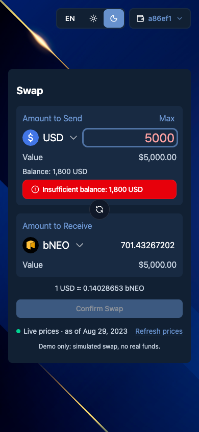
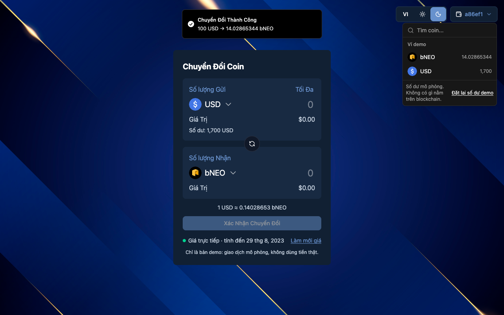

# Fancy Form — currency swap demo (Problem 2)

A currency-swap form built for the 99Tech challenge: pick two tokens, type an amount, see what you receive, confirm.
**Everything is simulated.** There is no wallet connection, no blockchain and no real money; balances live in your
browser's `localStorage` and the "server" is a timer.

|                            Dark                             |                             Light                             |
| :---------------------------------------------------------: | :-----------------------------------------------------------: |
|  |  |

|                       Phone, validation error                        |                        Vietnamese, wallet open                        |
| :------------------------------------------------------------------: | :-------------------------------------------------------------------: |
|  |  |

## Run it

Requires Node.js `^22.22.2 || ^24.15.0 || >=26` (`.nvmrc` says 26).

```bash
# from the repository root                 # or, inside problem2/fancy-form
npm run setup                               npm ci
npm run dev        # http://localhost:5173  npm run dev
```

| Command                 | What it does                                                       |
| ----------------------- | ------------------------------------------------------------------ |
| `npm run dev`           | Vite dev server                                                    |
| `npm run build`         | Typecheck + production build into `dist/`                          |
| `npm run preview`       | Serve the production build                                         |
| `npm run typecheck`     | `tsc -b`                                                           |
| `npm run lint`          | ESLint, type-aware, zero warnings allowed                          |
| `npm run format:check`  | Prettier                                                           |
| `npm run test -- --run` | Unit and component tests (Vitest)                                  |
| `npm run test:coverage` | Same, with a V8 coverage report                                    |
| `npm run test:e2e`      | Builds, then runs Playwright against `vite preview` in real Chrome |
| `npm run verify`        | typecheck, lint, format, tests, build                              |

E2E uses the Google Chrome installed on your machine. Without it: `E2E_BROWSER=chromium npx playwright install chromium`
and then `E2E_BROWSER=chromium npm run test:e2e`.

Optional, to run the production build in a container: `docker compose up --build`, then open http://localhost:5173.
(The Docker files are provided but were not exercised where this was written; see `../../MIGRATION.md`.)

## What you can do

- Choose the token to send and the token to receive. Both lists have an icon, the symbol and a **search** box; only
  tokens that have a valid price are offered. The sender list shows your balance next to each token and disables the
  ones you do not hold.
- Type an amount. The amount you receive, its USD value and the rate (`1 USD ≈ 0.14028653 bNEO`) update as you type.
  Typing a decimal comma (`12,5`) works.
- **Max** fills your exact balance. The round arrows between the two blocks swap the direction.
- **Confirm Swap** shows a pending state for 0.4–0.8 s (the simulated server), then debits one token and credits the
  other in a single step and shows a toast. A second click or Enter while pending is ignored.
- The wallet button (top right) lists your balances, can filter them, and has **Reset demo balance**. You start with
  1,800 USD.
- **EN / VI** and **sun / moon** switch language and theme. Both are remembered. Each theme has its own background image.
- Add `?simulate=failure` to the URL to see what happens when the server refuses a swap: an error toast, and the
  balance does not change.

Messages explain every refusal next to the field: empty, zero, negative, not a number (`abc`, `1e3`, `1.2.3`), more than
8 decimals, too large, more than your balance, the same token on both sides, no price for a token, prices not loaded.

## How it works

### Money maths (`src/domain`, pure TypeScript, no React)

```text
rate(from → to)  = price[from] / price[to]
amountToReceive  = amountToSend × price[from] / price[to]      (truncated, never rounded up, to 8 decimals)
```

Example in `swap.test.ts`: sending 3 of a token priced 2 USD for one priced 4 USD gives exactly **1.5**.

- All arithmetic uses `decimal.js`; balances are stored as decimal strings (`"1700"`, `"14.02865344"`), never as floats.
- The number shown as "you receive" is the very number credited to the wallet (the original showed 14.02 and
  credited 14.03).
- Amounts have at most 8 decimals. An amount, and any wallet balance, is at most 1,000,000,000,000 (one cap for
  both, so Max always works and nothing credited is ever dropped on reload). The price feed gives no per-token decimals, so
  this is a demo policy, not an on-chain precision.
- Functions: `normalizePriceData`, `quoteSwap`, `validateSwap`, `applyMockSwap`, `sanitizeBalances`. The balance is
  re-checked inside the wallet update itself, not just when the form rendered.

### Price data

Source: `https://interview.switcheo.com/prices.json`, an array of `{ currency, date, price }`, treated as untrusted.

- A record is used only if its currency, price (a positive finite number) and ISO-8601 date are all valid.
- When a currency appears several times (the real feed has 4 `USDC` and 2 `BUSD` records) the record with the **newest
  timestamp** wins; on equal timestamps the one **later in the feed** wins. (The original took the highest price.)
- A token without a valid price is not offered at all.
- 8 s timeout, 2 retries with back-off for network errors, timeouts and 5xx/429; cancelled on unmount; safe under
  React Strict Mode.
- If the live feed cannot be used, the app falls back to a bundled **sample** snapshot of the feed
  (`src/shared/constants/samplePrices.ts`). It is always labelled: an amber dot, **Sample prices**, the reason, and a
  **Retry** button. Live data shows a green dot, **Live prices**, and the date of the newest price. Note that this
  feed's own timestamps are from 2023-08-29.

### Layout

```text
src/
  domain/            pure logic + tests: decimal, prices, swap, wallet
  shared/api/        price fetching (timeout/retry/abort), simulated swap backend
  shared/hooks/      Zustand stores: wallet (persisted as "wallet-storage"), prices
  shared/config/     i18n (EN/VI bundled), router paths
  shared/components/ shadcn/ui pieces actually used, TokenIcon
  widgets/           SwapForm (+ useSwapForm), CoinSelected, CustomFormField, WalletDetail, SwitchTheme, LoadingScreen
  pages/Home, app/   page, router shell, providers, global CSS
e2e/                 Playwright specs
scripts/             import-graph.mjs (what the app really imports)
```

## Tests

`npm run test -- --run` — 251 tests, 93.5% statement coverage: money maths and validation, price normalisation
(including the real feed), the API client (timeouts, retries, cancellation), both stores (atomic commit, no overspend,
migration of the original storage format, a second tab spending the same money, storage that refuses writes), the whole form (quote, MAX, switch, validation, pending, double submit,
server refusal, balance re-check at commit time, fallback and Retry), theme, language, wallet and icons.

`npm run test:e2e` — 44 tests against the production build with the price API mocked: swap happy path, validation
paths, persistence and migration, theme and background images, EN/VI and the legacy `vn` code, API failure and
fallback, 5 viewports × 2 themes without horizontal overflow, amounts not clipped at 360/390 px, keyboard-only use,
and axe accessibility scans (light, dark, Vietnamese, open lists). Every test also fails on any console error.

## Accessibility

Real `<label>`s and accessible names on every control, errors announced with `role="alert"` and linked with
`aria-describedby`, visible focus rings, popovers named and closable with Esc (focus returns to the trigger), status
text in live regions, reduced motion respected, colour contrast checked by axe in both themes.

## Limitations

- Simulation only; do not read the rates as financial data.
- Token icons come from the challenge's repository; the 503 icons for tokens that are not in the feed were not kept.
- The "wallet address" `a86ef1` is a fixed label.
- The wallet is per browser profile. Open tabs stay in step through `storage` events, and a tab re-reads the saved
  wallet before it commits, so two tabs cannot spend the same money. If the browser blocks `localStorage` writes,
  the app keeps working in memory and simply does not persist.
- Price records are not capped in number; a deliberately gigantic feed could slow the token list down.
- Docker image build and the nginx configuration were not run (no Docker on the authoring machine).
